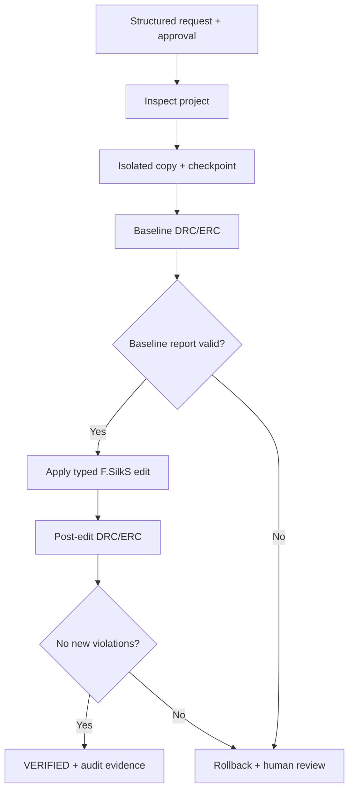

# BoardGuard

**Guarded execution for automated KiCad edits.**

BoardGuard turns a structured edit request into an isolated, validated, auditable change. It checks the project before and after the edit, compares validation findings, and rolls back when checks fail. The original project is never edited in place.

## Why it matters

An automation tool should provide more than a success message. BoardGuard produces a reviewable diff, before-and-after validation, rollback protection, and machine-readable evidence of what happened.

## How it works



## Guardrails

- **Constrained edits:** only non-electrical `F.SilkS` text inside the parsed board outline.
- **Controlled execution:** explicit approval, isolated workspaces, checkpoints, request idempotency, and rollback.
- **Auditable results:** before-and-after DRC/ERC, violation comparison, exact diffs, hashes, and secret-redacted JSONL traces.

## Quick start

Requires Python 3.11+.

```powershell
python -m venv .venv
.\.venv\Scripts\Activate.ps1
python -m pip install -e ".[test]"

boardguard demo
python -m pytest -q
```

`boardguard demo` uses a fault-injection simulator, not KiCad.

## Real KiCad validation

Install KiCad 8+ and ensure `kicad-cli` is on `PATH`.

```powershell
python scripts/fetch_reference_project.py
kicad-cli version
boardguard run examples/requests/antmicro_add_silk.json --backend kicad --approve
```

The optional downloader retrieves the Antmicro PDM microphone-board reference project and verifies its pinned Git blob hashes.

## Verified real-board run

**KiCad 10.0.7 · Antmicro PDM microphone board**

BoardGuard added a `BG` silkscreen label at `(243.4, 149.2) mm`.

| Check | Before | After |
|---|---:|---:|
| PCB DRC findings | 13 | 13 |
| Schematic ERC findings | 44 | 44 |
| New violations reported | — | 0 |

The exact PCB diff contains **one added text object and zero removed lines**. The original project was preserved.

Evidence: [`evidence/real-kicad/antmicro-add-label-006/`](evidence/real-kicad/antmicro-add-label-006/)

## Offline benchmark

Nine deterministic fault-injection scenarios, repeated three times per approach. Both approaches use the same simulator.

| Metric | Naive baseline | BoardGuard |
|---|---:|---:|
| Task completion | 11.1% | 44.4% |
| New violations left behind | 3 | 0 |
| Successful required rollbacks | 0/6 | 6/6 |
| Duplicate requests prevented | 0/3 | 3/3 |

These are simulator results, not real-world hardware performance measurements.

## Scope

The current edit surface is limited to silkscreen annotations. The real-KiCad result demonstrates one bounded workflow; DRC/ERC checks are not a certification of overall electrical correctness.

## License

BoardGuard code and its self-authored software fixture: MIT. The Antmicro reference design retains its upstream Apache-2.0 license and attribution.